<p align="center">
  
</p>

<p align="center">
  
  
  
  
</p>
<p align="center">
  
  
  
  
</p>

<h3 align="center">Turn every repo you own into one with a README that looks like the app, diagrams anyone can read, and a guide an AI assistant can follow.</h3>

<p align="center">
  <a href="#-what-it-does">What it does</a> ·
  <a href="#-built-in-themes">Built-in themes</a> ·
  <a href="#-how-it-works">How it works</a> ·
  <a href="#-two-repos-on-purpose">Two repos, on purpose</a> ·
  <a href="#-quick-start">Quick start</a> ·
  <a href="#️-whats-inside">What's inside</a> ·
  <a href="#-license">License</a>
</p>

> [!TIP]
> **🤖 Pasted this link into Claude or ChatGPT?** AI assistants: read [`AGENTS.md`](https://raw.githubusercontent.com/F0rger123/readme-kit/main/AGENTS.md) first. It explains what this is in plain words, which questions to ask, and how to set it up step by step. Plain-text index: [`llms.txt`](https://raw.githubusercontent.com/F0rger123/readme-kit/main/llms.txt).


<p align="center">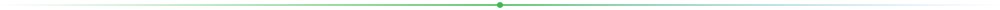</p>

## ✨ What it does

| | You get | How |
|---|---|---|
| 🎨 | **Banners that look like your app** | Animated SVG banners using the app's own colors and real fonts (embedded, so GitHub shows them) |
| 📸 | **Real screenshots** | Opens your app in a browser and captures it, even signed-in screens, using made-up demo data |
| 🗺️ | **Diagrams in plain English** | Mermaid diagrams in your brand colors that say what happens, not which file does it |
| 🤖 | **A guide for AI assistants** | `AGENTS.md` (or `docs/AI_GUIDE.md`) plus `llms.txt`, so anyone can paste the repo link into Claude or ChatGPT and be walked through setup |
| 🔁 | **Kept up to date** | A daily job gives new repos the full treatment; a weekly job refreshes repos that changed |
| 🔒 | **Safe by default** | Only touches docs, never prints secrets, and keeps your private projects' details in a separate private repo |

## 🎨 Built-in themes

<table>
  <tr>
    <td width="50%"><br><sub><b>mono</b> · black, Geist, numbered strip</sub></td>
    <td width="50%">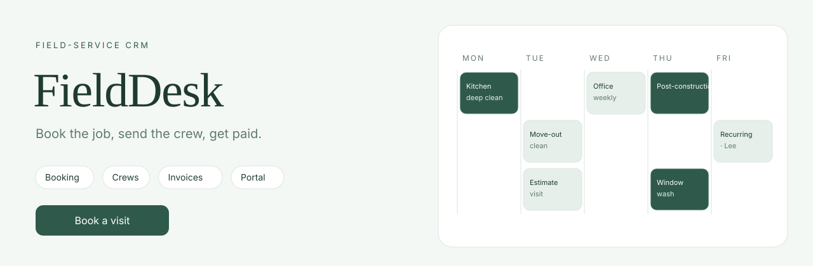<br><sub><b>fieldcrm</b> · calm CRM with a live schedule</sub></td>
  </tr>
  <tr>
    <td width="50%"><br><sub><b>indigo</b> · black and indigo glow</sub></td>
    <td width="50%"><br><sub><b>hud</b> · night dashboard with a gauge</sub></td>
  </tr>
  <tr>
    <td width="50%"><br><sub><b>island</b> · a morphing status pill</sub></td>
    <td width="50%"><br><sub><b>godcut</b> · video timeline</sub></td>
  </tr>
  <tr>
    <td width="50%"><br><sub><b>aether</b> · near-black IDE, one hot accent, a typing assistant</sub></td>
    <td width="50%"><br><sub><b>ledger</b> · warm paper and an approval inbox that stamps itself</sub></td>
  </tr>
  <tr>
    <td width="50%"><br><sub><b>forge</b> · markdown on the left builds a README on the right</sub></td>
    <td width="50%"><br><sub><b>blueprint</b> · light product blueprint and a wireframe that draws itself</sub></td>
  </tr>
  <tr>
    <td width="50%"><br><sub><b>heartbeat</b> · report header and a weekly commit pulse</sub></td>
    <td width="50%"><br><sub><b>reactor</b> · dark HUD with arc-reactor rings and a voice meter</sub></td>
  </tr>
  <tr>
    <td width="50%"><br><sub><b>pocket</b> · a phone with chat bubbles and a pulsing mic</sub></td>
    <td width="50%"><br><sub><b>digest</b> · a clock and two summary emails landing</sub></td>
  </tr>
  <tr>
    <td width="50%"><br><sub><b>popup</b> · a browser and an extension popup filling a sheet</sub></td>
    <td width="50%"><br><sub><b>pipeline</b> · a dark deal board where one deal reaches Closed</sub></td>
  </tr>
  <tr>
    <td width="50%"><br><sub><b>relay</b> · a request saved first, then fanned out</sub></td>
    <td width="50%"><br><sub><b>drafting</b> · a design sheet with agent nodes and an IN DESIGN stamp</sub></td>
  </tr>
  <tr>
    <td width="50%"><br><sub><b>tape</b> · hazard tape across an outlined wordmark</sub></td>
    <td width="50%"></td>
  </tr>
</table>

Repos without a theme get a generic animated banner; give every app its own theme so no two READMEs look alike. Add your own themes in your data folder (`data/themes.mjs`); they're merged over these.

## 🔁 How it works

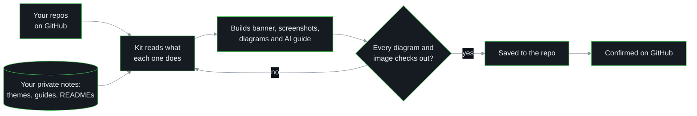

## 🧱 Two repos, on purpose

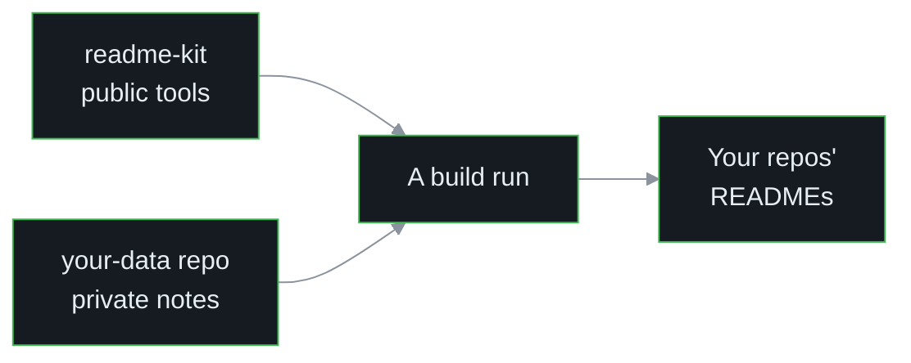

The tools are public; your data stays private. Clone your data repo into `data/` (or set `README_KIT_DATA`). Start from [`examples/data`](examples/data) to see the format.

## 🚀 Quick start

```bash
git clone https://github.com/F0rger123/readme-kit && cd readme-kit
npm install
cp -r examples/data data              # or: gh repo clone <you>/<your-data-repo> data
mkdir -p work && gh repo clone <you>/<repo> work/<repo>
npm run langs                          # language chart data, needs the GitHub CLI
node agents.mjs work                   # AI guides + llms.txt
node build.mjs work work/langs.txt     # READMEs, banners, licenses
node serve.mjs                         # preview at http://localhost:5179/view/<repo>
```

Screenshots: `node shoot.mjs node_modules/playwright-core jobs.json` (uses your installed Edge). The full runbook for scheduled jobs is in [`RUNBOOK.md`](RUNBOOK.md).

## 🗂️ What's inside

| File | Does |
|---|---|
| `build.mjs` | Builds each README from its source, adds badges, banner, nav, diagrams' colors and the AI-guide block |
| `themes.mjs` | Banner themes (fonts embedded) and the loader for your own |
| `agents.mjs` | Writes `AGENTS.md` / `docs/AI_GUIDE.md` and `llms.txt` from your guide notes |
| `shoot.mjs` | Takes screenshots with Playwright, including design-board frames and signed-in screens |
| `mock-supabase.mjs` | A pretend backend so signed-in screens render with demo data |
| `serve.mjs` | Local preview that renders READMEs like GitHub and checks every diagram |
| `scan-secrets.mjs` · `redact-lines.mjs` | Find leaked keys without ever printing them |
| `apply-lists.mjs` | Sorts your GitHub stars into Lists from a plan file |
| `fonts/` | Open-source fonts (SIL OFL) embedded into banners |

## 📜 License

Released under the [MIT License](LICENSE). Use it, fork it, ship it. Fonts are under the SIL Open Font License; see [`fonts/OFL.md`](fonts/OFL.md).

<p align="center"></p>

<p align="center">
  <sub>Built by <a href="https://github.com/F0rger123"><b>@F0rger123</b></a> · MIT licensed</sub>
</p>
