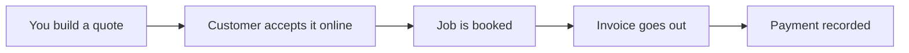

<!-- stack: next.js,react,typescript,supabase,cloudflare -->
{{HEADER}}

<h3 align="center">Every client, quote and invoice in one place.</h3>

{{NAV}}

{{DIVIDER}}

## 01 · What it does

| Module | What you get |
|---|---|
| **Clients** | Every customer and their history |
| **Quotes** | Send a quote, get it accepted online |
| **Invoices** | Bill the job and record the payment |

## 02 · From quote to paid

## 03 · What it's written in

{{LANGS}}

## License

{{LICENSE}}

{{FOOTER}}
